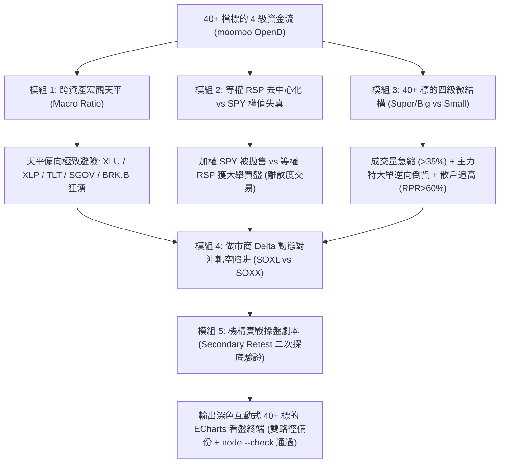

# 華爾街機構級：美股 40+ 核心標的群 × 11大板塊輪動與「死貓反彈 vs 趨勢反轉」量化看盤終端 (`quant-us-sector-flow-terminal`)

本技能為華爾街一線對沖基金、量化自營交易台與做市商量化診斷工具，深度整合美股全市場跨資產宏觀資金輪動、11 大 GICS 板塊去向，以及暴跌後科技與半導體股強彈時的微結構量化分析。

---

## 一、40+ 核心成分標的池分類體系

本技能已將華爾街機構重點配置之 40+ 核心資產進行專業分群：

| 核心板塊族群 | 納入成分標的代號 | 機構量化定位與分析重點 |
| :--- | :--- | :--- |
| **AI算力與先進製程** | `TSM`, `NVDA`, `AMD`, `AVGO`, `ARM`, `QCOM`, `INTC` | 算力總舵手與晶圓代工封裝，監控特大/大單是否有趁彈倒貨 |
| **超大規模雲端巨頭** | `AMZN`, `GOOGL`, `MSFT`, `META` | Hyperscalers 資本支出 (Capex) 承諾與雲端防禦性現金流 |
| **智慧車與太空探索** | `TSLA`, `SPCX` | 自駕 FSD / 機器人 Dojo 算力與低軌衛星太空產業鏈 |
| **資料中心與算力基建** | `ORCL`, `APLD`, `NBIS`, `CORZ`, `IREN`, `CRWV` | HPC 液冷資料中心、礦場轉型高效算力租賃與電力資源 |
| **記憶體與存儲技術** | `MU`, `SNDK`, `STX`, `WDC` | HBM3e/HBM4 高頻寬記憶體、NAND Flash 與企業級硬碟儲存 |
| **光模組與矽光網通** | `AAOI`, `LITE`, `COHR`, `CSCO` | 800G/1.6T 光收發模組、垂直整合矽光子材料與交換器 |
| **生成式 AI 主題 ETF** | `CHAT`, `AIQ`, `BAI`, `ARTY` | 主動與被動型生成式 AI 應用 ETF 資金吸納與贖回強度 |
| **晶片與科技巨頭 ETF** | `SMH`, `SOXX`, `MAGS`, `XLK`, `IGV` | 費半 1X 基準、VanEck 晶片、科技七巨頭與軟體行業 ETF |
| **市值基準與大盤成長 ETF**| `QQQ`, `SPY`, `IVW`, `SCHG` | 那斯達克 100、標普 500 加權基準、標普純成長與嘉信大盤成長 |
| **宏觀避險與等權離散** | `XLU`, `XLP`, `RSP`, `TLT`, `SGOV`, `GLD`, `BRK.B`, `SOXL`, `XLF`, `XLB` | 跨資產避險天平 (Macro Ratio)、等權 RSP 去中心化與 3X 槓桿陷阱 |

---

## 二、六大量化微結構模組



1. **宏觀跨資產天平 (Macro Scale Ratio)**：
   $$\text{Macro Ratio} = \frac{\sum \text{Inflow}_{\text{SafeHaven}}}{\sum |\text{Outflow}_{\text{Tech/Cyclicals}}|}$$
   當天平湧入避險資產（公用事業 `XLU`、超短美債 `SGOV`、等權 `RSP`、波克夏 `BRK.B`）顯著超越科技股流出時，定性為**系統性去槓桿 (De-grossing)**。
2. **等權 RSP 去中心化 (Equal-Weight Dispersion)**：
   市值加權指數受科技巨頭拋售拖累，但等權標普 (`RSP`) 逆勢獲 $+2.87$ 億美元淨流入，證實非全面性熊市，而是**離散度交易 (Dispersion Trading)**。
3. **「死貓反彈 vs 趨勢反轉」微結構判定**：
   - **量縮比率** $\Delta V\% < -35\%$：無量流動性真空拉抬。
   - **四級資金背離**：股價收紅但主力淨額 $\text{Main Flow} < 0$ 且散戶參與率 $RPR > 60\%$（如輝達大單淨賣 $-8,096$ 萬$、美光特大單拋售 $-5,712$ 萬$、台積電散戶買盤佔 64.5%）。
4. **做市商 Delta 動態對沖軋空陷阱 (SOXL vs SOXX)**：
   散戶搶進 3X 槓桿 ETF 迫使做市商買入 1X 指數避險，造就指數反抽，但機構趁機倒貨成分股，且槓桿損耗極高（$-38.7\%$ 跌幅需 $+63.2\%$ 回本）。
5. **資料中心、光模組與記憶體族群分化解構**：
   - 資料中心 HPC：具實質雲合約（ORCL、CRWV）抗跌；純挖礦概念（CORZ、IREN）隨 Beta 回檔。
   - 光模組：高速 800G/1.6T 需求堅韌（LITE、COHR），但短線受制於半導體設備解套賣壓。
6. **投行觀點與二次探底 (Secondary Retest) 操盤劇本**：
   週一開盤嚴禁追高，耐心等待前波恐慌低點縮量不破的雙底確認訊號。

---

## 三、執行指令與參數

### 1. 執行 40+ 核心標的群全景分析
```powershell
python C:\Users\Anu\.gemini\config\skills\quant-us-sector-flow-terminal\scripts\quant_us_sector_flow.py --date 2026-11-06
```

### 2. 指定自訂標的與自訂檔名
```powershell
python C:\Users\Anu\.gemini\config\skills\quant-us-sector-flow-terminal\scripts\quant_us_sector_flow.py --tickers US.NVDA US.AMD US.TSM US.AVGO US.MSFT US.ORCL US.MU US.SOXL --out My_Custom_Report.html
```

---

## 四、檔案連結

* 技能指導手冊：[`SKILL.md`](file:///C:/Users/Anu/.gemini/config/skills/quant-us-sector-flow-terminal/SKILL.md)
* 核心運算腳本：[`quant_us_sector_flow.py`](file:///C:/Users/Anu/.gemini/config/skills/quant-us-sector-flow-terminal/scripts/quant_us_sector_flow.py)
* 量化公式與操作手冊：[`institutional_flow_playbook.md`](file:///C:/Users/Anu/.gemini/config/skills/quant-us-sector-flow-terminal/references/institutional_flow_playbook.md)
* 40+ 標的最新看盤終端：[`US_Comprehensive_40Tickers_Terminal_20261106.html`](file:///D:/Python/_tmp/US_Comprehensive_40Tickers_Terminal_20261106.html)
